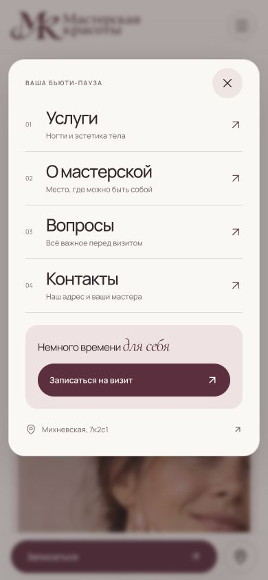
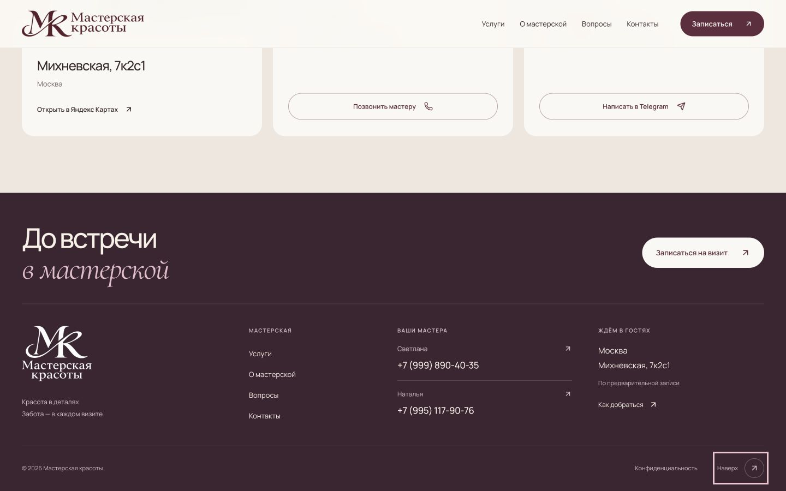
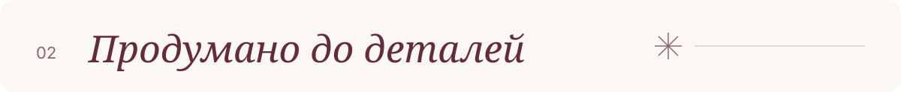

<p align="center">
  
</p>

<p align="center">
  <a href="https://lucem-afferens.github.io/masterskaya-krasoty/"><strong>Открыть сайт ↗</strong></a>
  &nbsp; · &nbsp;
  <a href="#локальный-запуск">Запустить локально</a>
  &nbsp; · &nbsp;
  <a href="./DESIGN.md">Дизайн и философия</a>
</p>

Адаптивный сайт **«Мастерской красоты»** на Михневской, 7к2с1. Помогает выбрать уход, познакомиться с пространством и договориться о визите напрямую с мастером.

<p align="center">
  <a href="https://lucem-afferens.github.io/masterskaya-krasoty/">
    
  </a>
</p>

**Next.js 16 · React 19 · TypeScript · Статический экспорт · GitHub Pages**

<p align="center">
  
</p>

## От выбора услуги до визита

**Выбрать направление → обсудить детали с мастером → прийти в мастерскую**

| Направление | Идея | Что внутри |
| --- | --- | --- |
| Ногтевой сервис | До кончиков пальцев | Маникюр, педикюр, наращивание, дизайн |
| Эстетика тела | В каждом изгибе | Аппаратные процедуры и эстетический уход |

- **Понятная запись.** Окно с выбранной услугой, контактом мастера и копированием номера. Телефон для обоих направлений, Telegram — для эстетики тела.
- **Удобство на телефоне.** Крупные ссылки в меню, отдельный блок записи, фиксированная нижняя кнопка и адаптивные колонки футера.
- **Настоящее пространство.** Галерея фотографий мастерской, адрес и интерактивная карта с меткой здания.
- **Забота о деталях.** Клавиатурная навигация, Escape для диалогов, видимый фокус и поддержка уменьшенного движения.

Время и стоимость подтверждает мастер. Сайт не создаёт онлайн-бронирование и не показывает фиктивные свободные слоты, цены или отзывы. Изображение на первом экране создано с помощью AI и подписано; фотографии интерьера — реальные.

<details>
  <summary><strong>Посмотреть мобильное меню и футер</strong></summary>

  <p align="center">
    
  </p>
  <p align="center">
    
  </p>
</details>

<p align="center">
  
</p>

## Локальный запуск

Нужны **Node.js 22.13+** и npm.

```sh
git clone https://github.com/Lucem-afferens/masterskaya-krasoty.git
cd masterskaya-krasoty
npm ci
npm run dev
```

Откройте **[localhost:5173](http://127.0.0.1:5173)** — изменения обновляются автоматически.

Для проверки production-сборки:

```sh
npm run build
npm start
```

Готовый сайт доступен на **[localhost:3000](http://127.0.0.1:3000)**. База данных и API-ключи не нужны. Шрифты и изображения локальные; карта и Telegram используют внешние сервисы.

## Публикация

**[lucem-afferens.github.io/masterskaya-krasoty](https://lucem-afferens.github.io/masterskaya-krasoty/)**

Исходники хранятся в `main`, готовый сайт — в `gh-pages`. GitHub Pages публикует корень ветки `gh-pages`. Для обновления сайта из локальной копии:

```sh
git add .
git commit -m "Update studio website"
git push origin main
npm run deploy:pages
```

Команда требует чистого рабочего дерева и права записи в репозиторий. Она собирает сайт с префиксом `/masterskaya-krasoty`, создаёт обычный коммит в `gh-pages` и отправляет его без перезаписи истории. Изменения только в `main` сами по себе не обновляют опубликованный сайт.

<details>
  <summary><strong>Проверить сборку для Pages локально</strong></summary>

```sh
npm run build:pages
npm start
```

Откройте [localhost:3000/masterskaya-krasoty/](http://127.0.0.1:3000/masterskaya-krasoty/). Если сервер уже запущен, перезапустите его после смены типа сборки.

</details>

## Где что находится

| Путь | Назначение |
| --- | --- |
| `lib/studio.ts` | Услуги, контакты, расписания, FAQ |
| `app/page.tsx` | Главная страница, запись, меню и галерея |
| `app/globals.css` | Цвета, типографика, сетки и адаптивность |
| `app/layout.tsx` | Метаданные и schema.org |
| `lib/paths.ts` | Пути для корневого домена и GitHub Pages |
| `public/` | Логотипы, фотографии, иконки и шрифты |
| `assets/readme/` | SVG-оформление и реальные скриншоты README |
| `scripts/` | Локальный сервер, проверки и публикация |

## Проверки и материалы

```sh
npm run check
# При запущенном локальном сервере:
npm run test:smoke
```

Проверки охватывают страницы, реальные контакты, структурированные данные, изображения, логотипы, стили, скрипты, локальные шрифты и страницу 404. Для другого адреса задайте `SITE_TEST_URL`.

- [Проверки и ограничения тестирования](./QA.md)
- [Визуальная система и обоснование решений](./DESIGN.md)
- [Подробная инструкция запуска и размещения](./docs/SETUP.md)
- [Промпт редакционного изображения](./IMAGE-PROMPT.txt) · [Промпты логотипа](./BRAND-PROMPTS.txt)

Исходники опубликованы для просмотра проекта. Открытая лицензия на код, фирменную символику и фотографии не предоставлена; повторное использование согласуется с правообладателем. Лицензии шрифтов сохранены в [`public/fonts/`](./public/fonts/).
